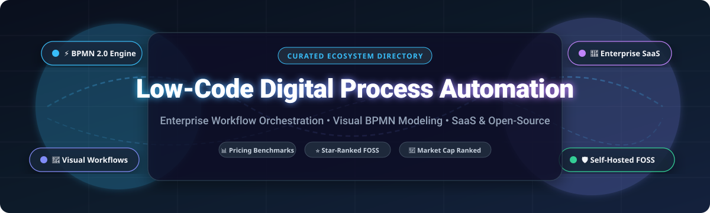

  

# 🚀 Awesome Low-Code Digital Process Automation (DPA)

  
  
  
  
  
  
  
  

> A curated directory of leading **Low-Code Digital Process Automation (DPA)**, **Business Process Management (BPM)**, and **Enterprise Workflow Automation** platforms. Covering top commercial SaaS solutions with verified pricing benchmarks and high-performance open-source/self-hosted alternatives.

**📅 Last updated: March 2026**

---

### 💡 Why Low-Code Digital Process Automation?

**Digital Process Automation (DPA)** represents the evolution of Business Process Management (BPM) into an agile, cloud-native paradigm. By uniting visual process modeling (BPMN 2.0 / DMN), drag-and-drop form builders, robotic process automation (RPA), and enterprise system integration, low-code DPA platforms enable organizations to:
- ⚡ **Accelerate Time-to-Market:** Deliver mission-critical business applications and straight-through workflows 5x–10x faster than traditional hand-coding.
- 👥 **Democratize Development:** Empower citizen developers and business analysts while enforcing enterprise IT security, governance, and audit trails.
- 🔗 **Eliminate Operational Silos:** Orchestrate end-to-end human-in-the-loop tasks and automated background microservices across legacy ERPs, CRMs, and modern cloud APIs.
- 🛡️ **Preserve Data Sovereignty:** Leverage robust open-source and self-hosted workflow engines for complete regulatory compliance (GDPR, HIPAA, SOC 2) and zero vendor lock-in.

## 📑 Table of Contents

- [📈 Sector Overview & Market Dynamics](#-sector-overview--market-dynamics)
- [☁️ SaaS/Hosted Platforms](#️-saashosted-platforms)
- [🔓 Open-Source GitHub Projects](#-open-source-github-projects)
- [⭐ Star History](#-star-history)
- [🤝 Support & Sponsorship](#-support--sponsorship)
- [🤝 How to Contribute](#-how-to-contribute)
- [⚠️ Disclaimer](#️-disclaimer)

## 📈 Sector Overview & Market Dynamics

The global Digital Process Automation (DPA) market is valued at approximately **$17.2 billion to $21.9 billion in 2026** (growing from ~$15.4B–$19.6B in 2025 at an 11%–12.5% CAGR). The market exhibits **moderate concentration**: mega-cap enterprise vendors (Microsoft, Salesforce, Pegasystems, Appian, Siemens/Mendix) command core high-end mission-critical deployments, while a dynamic, fragmented landscape of verticalized low-code tools and open-source orchestrators captures significant agile and mid-market process workflows.

## ☁️ SaaS/Hosted Platforms

| Platform | Company Scale (Valuation / Revenue) | Starting Pricing Tier | Free Tier Limit / Free Trial | Description |
| :--- | :--- | :--- | :--- | :--- |
| **[Microsoft Power Apps](https://powerapps.microsoft.com/)** | ~$3.1T Market Cap / ~$245B Ann. Rev. (Microsoft) | $20/user/month (Power Apps Premium; or $5/user/app/month) | Free Developer Plan (perpetual free non-production sandbox environment); or 30-day free trial (extendable up to 90 days) | Enterprise low-code platform for building custom business applications with native Dataverse and 1,000+ connectors. |
| **[Salesforce OmniStudio](https://www.salesforce.com/)** | ~$280B Market Cap / ~$38B Ann. Rev. (Salesforce) | Included with Salesforce Industry Cloud Enterprise editions (from $300/user/month) or add-on packages | 30-day trial orgs / Free perpetual Trailhead Developer Edition orgs pre-configured with OmniStudio Designer | Declarative suite for guided digital experiences, OmniScripts, FlexCards, and Integration Procedures. |
| **[Mendix](https://www.mendix.com/)** | ~$140B Market Cap (Parent Siemens; acquired for $730M) | $1,090/month (Standard Tier for single app; billed annually) | Free for life plan (0.5 vCPU, 0.5 GB database, 1 GB file storage, sleeps after 1 hr of inactivity, up to 5 users) | Enterprise model-driven low-code application development platform with visual modeling and multi-cloud deployment. |
| **[Pega Platform](https://www.pega.com/)** | ~$7.5B Market Cap / ~$1.4B Ann. Rev. (Pegasystems) | $90/user/month (Base case management tier; or ~$0.45/case pack entry) | 30-day free trial (Pega Community Edition, extendable once by 15 days to 45 days total; non-production) | Enterprise AI-driven workflow automation, case management, decisioning engine, and low-code app development. |
| **[OutSystems](https://www.outsystems.com/)** | ~$4.3B Valuation (Private; backing from KKR & Goldman Sachs) | $36,300/year (Base entry tier for OutSystems Developer Cloud ODC) | Free Developer / Personal Edition (perpetual, 1 environment, up to 100 users, 2 GB DB, sleeps if inactive, non-production) | High-performance low-code platform for enterprise-grade web and mobile applications with automated DevOps. |
| **[Appian](https://appian.com/)** | ~$2.4B Market Cap / ~$600M Ann. Rev. (Appian Corp) | ~$75/user/month (Standard entry tier, typically subject to annual minimum commitments) | Free perpetual Community Edition (personal dedicated cloud sandbox for evaluation/learning, non-production) | Enterprise low-code automation platform integrating process mining, BPMN process modeling, and RPA. |
| **[Nintex](https://www.nintex.com/)** | ~$2B+ Valuation (Private; acquired by TPG Capital) | $625/month (Pro workflow starter tier, billed annually) | 30-day free trial (full access to Nintex Workflow Cloud & Process Manager, no credit card required) | End-to-end process intelligence and workflow automation suite featuring forms, robotic automation, and eSignatures. |
| **[Camunda Cloud](https://camunda.com/)** | ~$1B+ Valuation (Private; Series B unicorn) | $99/month (Starter tier for execution; Enterprise custom) | Free Plan (perpetual free collaborative Web Modeler up to 5 user seats; includes 30-day process execution cluster trial) | Cloud-native workflow orchestration and decision automation platform powered by Zeebe BPMN 2.0 engine. |
| **[Kissflow](https://kissflow.com/)** | ~$500M Valuation / ~$40M Ann. Rev. (OrangeScape) | $1,500/month (Basic entry tier, billed annually) | 14-day free trial (guided proof-of-concept environment available upon solution consultation) | Low-code/no-code digital workplace platform uniting workflow automation, case management, and form approvals. |
| **[FlowForma](https://www.flowforma.com/)** | SME (~$10M–$20M Valuation / ~$5M Ann. Rev.) | $2,347/month (Essentials plan covering up to 3 end-to-end processes, billed annually) | 7-day free trial (full access to forms, workflow engine, and AI agents, no credit card required) | No-code digital process automation solution built directly on Microsoft 365 and SharePoint ecosystems. |

## 🔓 Open-Source GitHub Projects

- **[n8n](https://github.com/n8n-io/n8n)**   
  Fair-code workflow automation platform with a visual canvas, 400+ native integrations, and advanced webhook orchestration for automating complex business processes.

- **[NocoDB](https://github.com/nocodb/nocodb)**   
  Open-source no-code/low-code platform that transforms any relational database (PostgreSQL, MySQL, SQLite, SQL Server) into a smart spreadsheet and process management database with webhooks and workflow automations.

- **[Apache Airflow](https://github.com/apache/airflow)**   
  Open-source workflow management and orchestration platform with programmatic DAG scheduling, rich enterprise integrations, and monitoring for business process pipelines.

- **[ToolJet](https://github.com/ToolJet/ToolJet)**   
  Open-source low-code platform for building enterprise internal tools, process forms, and automated business workflows with visual app builders, JavaScript/Python logic, and 50+ data sources.

- **[Appsmith](https://github.com/appsmithorg/appsmith)**   
  Open-source low-code framework to build custom administrative panels, workflow dashboards, and approval portals connected to any database or REST API with drag-and-drop UI widgets.

- **[Kestra](https://github.com/kestra-io/kestra)**   
  Declarative, event-driven orchestration and workflow automation platform with YAML definitions, 500+ plugins, and an interactive UI for business operations and data pipelines.

- **[Budibase](https://github.com/Budibase/budibase)**   
  Open-source low-code platform for building business apps, forms, approval workflows, and internal portals. Supports PostgreSQL, MySQL, MongoDB, REST APIs, Docker, and Kubernetes.

- **[Activepieces](https://github.com/activepieces/activepieces)**   
  Open-source, self-hosted visual workflow automation platform designed as a modern alternative to Zapier and Make, featuring enterprise low-code triggers, AI copilots, and 200+ app connectors.

- **[Node-RED](https://github.com/node-red/node-red)**   
  Low-code visual event-driven flow-based development environment for wiring together hardware devices, APIs, and online services with a rich browser-based flow editor.

- **[Temporal](https://github.com/temporalio/temporal)**   
  Durable execution platform for orchestrating mission-critical, long-running business workflows, state machines, and human-in-the-loop digital processes with complete fault tolerance.

- **[Automatisch](https://github.com/automatisch/automatisch)**   
  Open-source, privacy-focused business automation tool designed for self-hosting without transmitting data to third parties, offering visual workflows and multi-service connectors.

- **[Activiti](https://github.com/Activiti/Activiti)**   
  Battle-tested, lightweight open-source business process management (BPMN 2.0) and workflow suite designed for cloud-native enterprise application runtimes.

- **[Flowable](https://github.com/flowable/flowable-engine)**   
  Compact and highly efficient open-source BPMN 2.0, CMMN 1.1, and DMN 1.2 business process and case management engine written in Java for enterprise workflow automation.

- **[Camunda Platform 7](https://github.com/camunda/camunda-bpm-platform)**   
  Standard open-source framework for business process management and decision automation, providing Java and REST APIs, Web Modeler, Tasklist, and Cockpit monitoring.

- **[Corteza](https://github.com/cortezaproject/corteza)**   
  Open-source low-code digital operations platform (Apache 2.0) for building CRM, process management, and structured records. Features visual app builders, BPMN 2.0 workflow orchestration, and granular RBAC.

- **[Lowcoder](https://github.com/lowcoder-org/lowcoder)**   
  Open-source low-code platform for building business tools, custom internal applications, and enterprise dashboards with drag-and-drop UI components, custom plugins, and query connectors.

- **[Jmix](https://github.com/jmix-framework/jmix)**   
  Open-source Java full-stack framework with rapid application development tools, visual data modeling, and automated UI scaffolding for enterprise back-office and workflow applications.

- **[Joget DX](https://github.com/jogetworkflow/jw-community)**   
  Open-source no-code/low-code platform combining workflow automation with AI assistance. Features visual process modeling, form builders, and plugin architecture for enterprise digital transformation.

- **[REI3](https://github.com/r3-team/r3)**   
  Open-source low-code application platform built with Go and PostgreSQL for rapidly designing and hosting multi-user business systems without vendor lock-in.

- **[ProcessMaker](https://github.com/ProcessMaker/processmaker)**   
  Open-source digital process automation and workflow management platform featuring drag-and-drop BPMN 2.0 modeling, responsive form building, and user approval task routing.

- **[formsflow.ai](https://github.com/AOT-Technologies/forms-flow-ai)**   
  Open-source low-code platform integrating form builders, Camunda BPM workflow engine, keycloak identity management, and analytics for public sector and enterprise digital processes.

- **[Convertigo](https://github.com/convertigo/convertigo)**   
  Enterprise open-source low-code and no-code platform with visual backend integration, FullSync offline data capabilities, and mobile/web application builders.

- **[Baker](https://github.com/ing-bank/baker)**   
  ING Bank's open-source microservice workflow orchestration platform based on Petri nets, engineered for high-throughput straight-through process execution and auditability.

- **[Zango](https://github.com/Healthlane-Technologies/Zango)**   
  Open-source Python and Django-based framework for creating secure, enterprise-grade multi-tenant web applications and backend automation microservices.

- **[Tabbled](https://github.com/tabbled/tabbled)**   
  Self-hosted low-code web application platform for building operational business systems like CRM, ERP, and inventory management with TypeScript.

- **[Fluxnova](https://github.com/finos/fluxnova-bpm-platform)**   
  FINOS open-source BPMN 2.0 and DMN workflow orchestration platform community-engineered for fintech and financial institutions requiring rigorous enterprise process compliance.

- **[A12 Tutorial Application](https://github.com/mgm-tp/a12-tutorial-application)**   
  Sample application and developer documentation for mgm technology partners' A12 enterprise low-code modeling platform, powering large-scale European governmental systems.

- **[pgkiln](https://github.com/pgkiln/pgkiln)**   
  SQL-driven low-code application builder for PostgreSQL modeled after Oracle APEX, storing pages, items, and automated process steps directly in relational metadata schemas.

🧩 **Frameworks for building custom systems**: Combine **Corteza** for low-code application building, **Joget DX** for AI-powered process automation, **Camunda** or **Flowable** for BPMN orchestration, **Budibase** or **Lowcoder** for internal tools, and **PostgreSQL + Metabase** for process analytics to build a complete self-hosted low-code automation stack.

## ⭐ Star History

## 🤝 Support & Sponsorship

Thank you so much for exploring and supporting this curated resource! 🌟  

If you find this repository valuable:
- ⭐ **Star** this repository to show your appreciation and help others discover it.
- 🍴 **Fork** and contribute new process automation tools or pricing updates via pull requests.
- 📢 **Share** this collection with your fellow developers, enterprise architects, and automation teams.
- ☕ **Sponsor / Buy a coffee**: If you'd like to back ongoing research and maintenance, feel free to support directly through the [GitHub Sponsor Dashboard](https://github.com/sponsors/ishandutta2007). Your support helps keep this directory continuously updated and accurate!

## 🤝 How to Contribute

1. Fork the repo.
2. Add/edit entries in `README.md` (follow existing format).
3. Include: name, link, 1–2 sentence description, and whether it's SaaS or open-source.
4. Submit PR with a short explanation.

Star the repo if you find it useful!

## ⚠️ Disclaimer

- This is a **community-curated** list — not exhaustive and not an endorsement.
- Low-code process automation tools must comply with data protection regulations (GDPR, CCPA), industry standards (SOC 2), and accessibility requirements (WCAG).
- Self-hosted open-source solutions require proper security hardening, infrastructure management, and governance controls.

---

**Made with ❤️ for business process managers, enterprise architects, citizen developers, and developers building low-code automation platforms.**  
Let's make low-code digital process automation more open, data-sovereign, and developer-friendly.
